# Elevator
The purpose of this README is to document the build process for the Fake Elevator for the 'Novemberspuck' of 2026.

## 2026-09-02 First sketch
We sketched on a whiteboard where our elevator should go and what features we'll include.
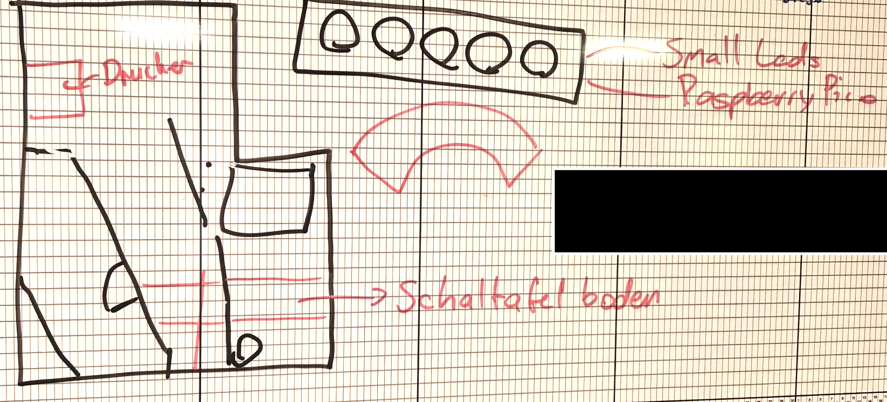

## 2026-09-05 First build
We went ahead and bought everything we needed for the elevator, including spray paint, a mirror and mounting hardware for the door. We measured the final placement of the lift to determine the height of the fake floor required to let the lift go down a bit. While my partner built the rough elevator, I figured out how to program a servo and control it via buttons to create an elevator display showing the floor you are on and simulating floor movement. We spent a lot of time trying to figure out the door movements. The problem is that the elevator isn't very wide, so we decided that the door would be made of three pieces, with only two moving in one direction. The mechanism is not yet fully functional.

### Rough Elevator build
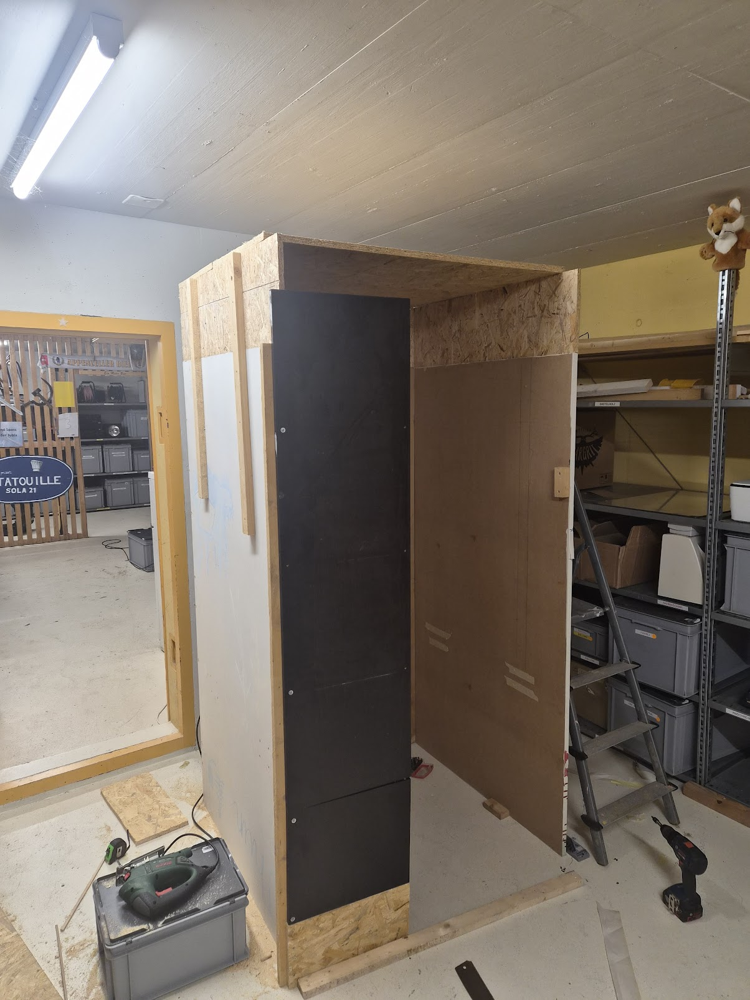
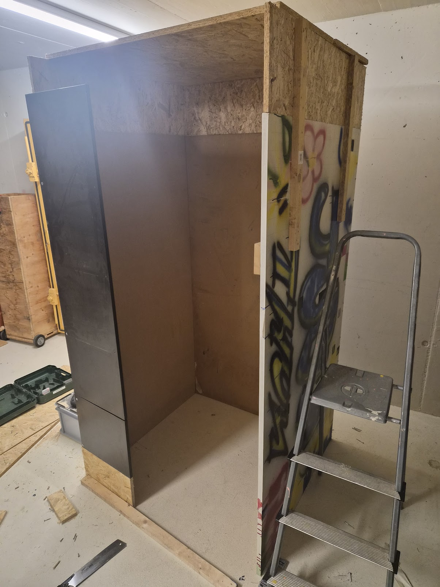

### First door mechanism
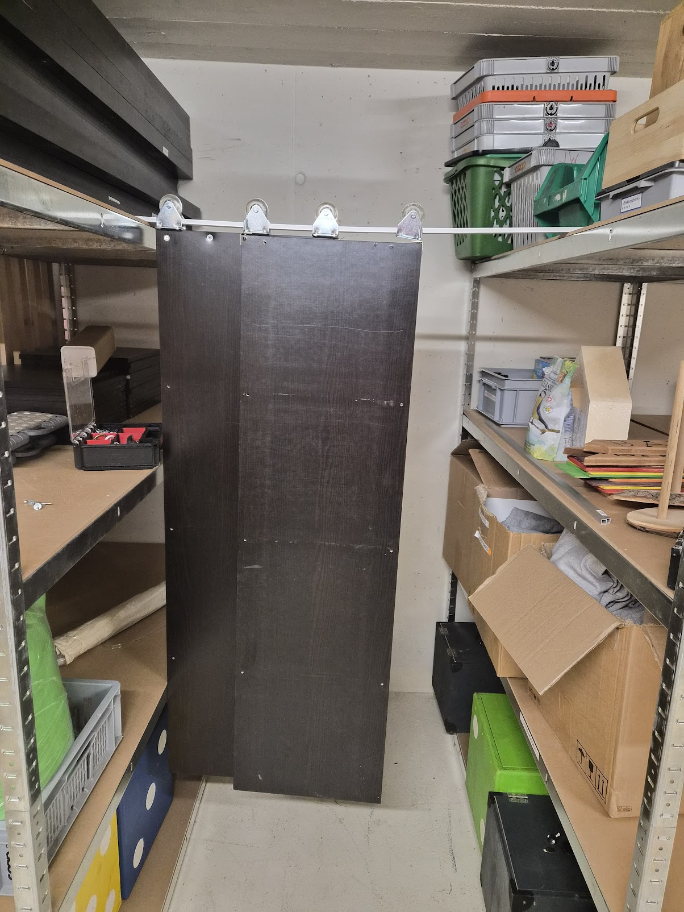

### Elevator Display prototype
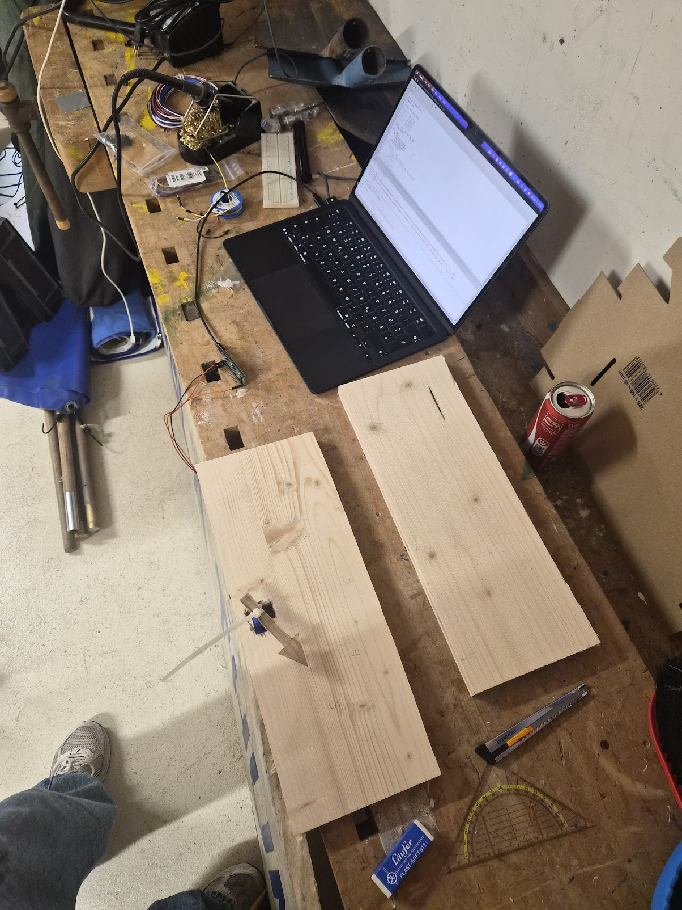

## 2026-10-24
We rethought our elevator doors. The doors running on the metal square pipes only worked partially. The doors were built using IKEA Kalax boards, which are very light; however, the doors were already sagging. Using the IKEA Kalax boards as the doors was also not the brightest idea. IKEA isn't exactly known for making strong wooden furniture. Therefore, sometimes the screws we put into the borads fell out again instantly. It's basically cardboard. That's why we decided to change the door panels the next time we work on them. Our new door rail uses a round steel pipe that doesn't bend as much, and we have also put an extra supportive rod into the steel pipe.

### Old door rail
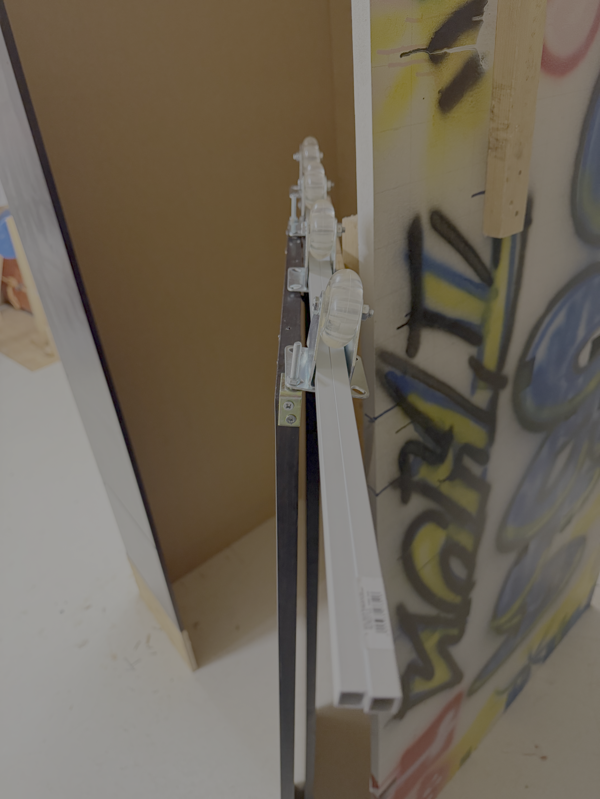

### New door rail

## 2026-11-02
In the meantime, I designed an elevator display for the servo, which will be controlled by a Raspberry Pi Pico connected to five buttons. I printed the display at school, but failed to measure the servo correctly. As we don't have much time left, I won't be able to print it again. That's why I took a drill and drilled a bigger hole. It was a bit scary and sketchy, but it worked!

### 3D-Printed Display
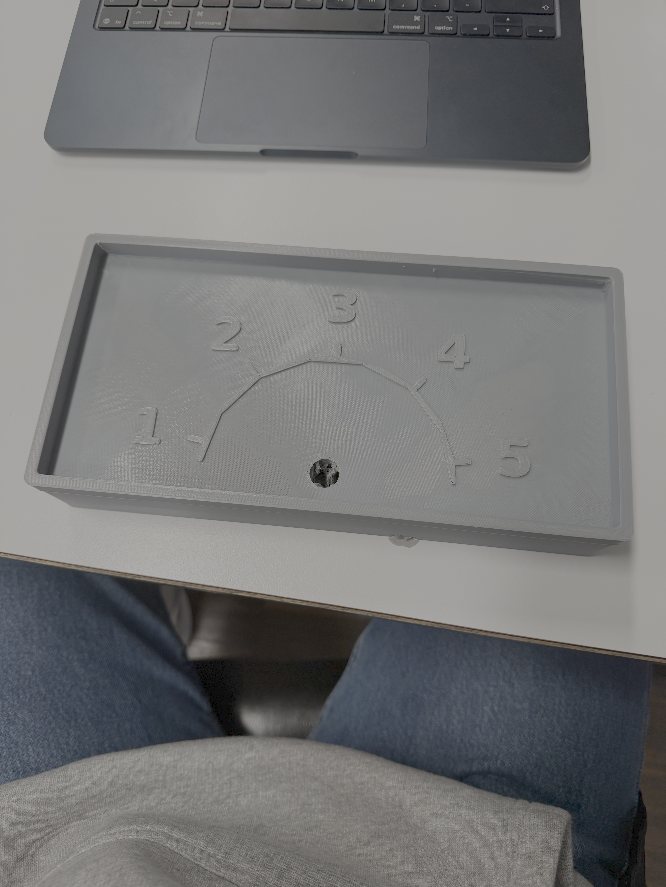

### Failed measurement
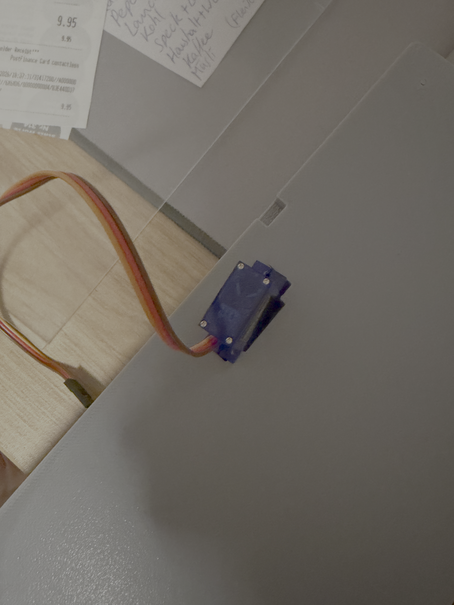

## 2026-11-08
We are starting to feel the pressure as the deadline is next weekend and we haven't started painting yet. We don't have the complete buttons either. However, we were able to replace the Kalax boards with some actual wooden ones. We also added small wheels to the bottom of the doors so that they don't sag anymore. We added rope to open and close the doors, and it works perfectly. I went ahead and connected all the buttons and assembled the display. I installed the display and drilled holes for the buttons. The buttons are labelled. We still need to paint it, install the mirror, camera and lights, and figure out how to add sound effects.

### Changed doors
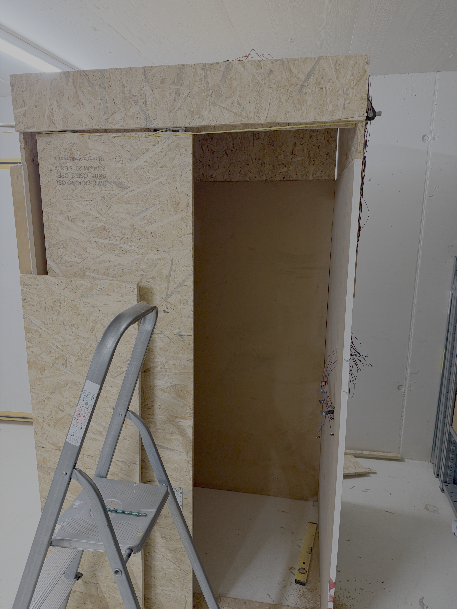

### Installed display
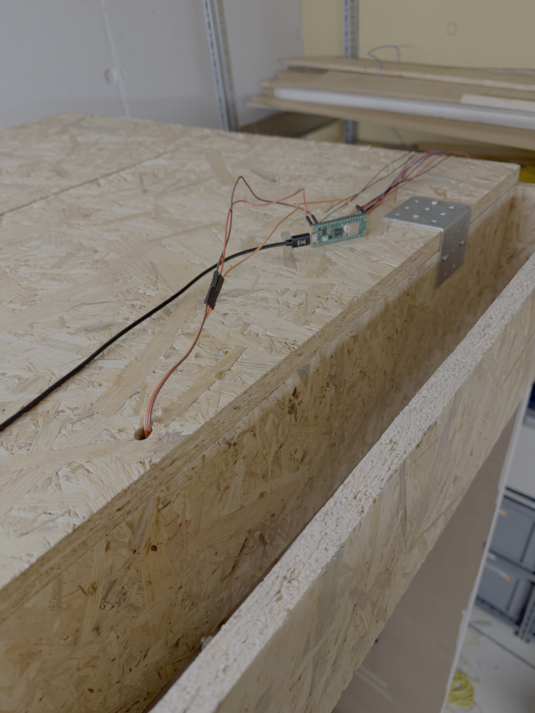
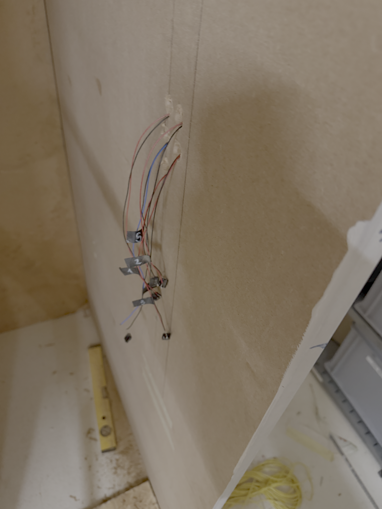
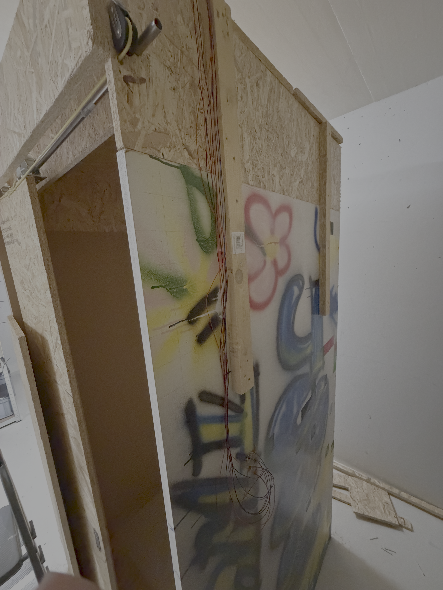